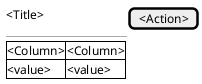

# UI design: <slice name>

<!-- The visual file for this slice's user-facing UI (kit 1.211.0), written by /crav1-design-ui.
Look, layout, colours and fonts, plus the tokens. Tokens live here; there is no separate tokens file.
The written Markdown is the source of truth: a mock under ui/mock/ or a picture that disagrees with it loses.
A screen's layout sits under the same `### <name> (S<n>)` heading as in ui/experience.md. -->

## Look

<Two or three sentences: the feel, the density, and what the eye lands on first.>

## Tokens

```yaml
colors:
  background: "<#ffffff>"
  surface: "<#f5f6f8>"
  text: "<#1d232b>"
  primary: "<#2457c5>"
  danger: "<#b42318>"
typography:
  body: { family: "<font family>", size: "14px", weight: 400, line-height: "20px" }
  heading: { family: "<font family>", size: "20px", weight: 600, line-height: "28px" }
spacing: { xs: "4px", sm: "8px", md: "16px", lg: "24px" }
radius: { sm: "4px", md: "8px" }
```

- Colours: <when primary, danger and surface are used>
- Typography: <where body and heading text appear>
- Spacing and radius: <the default gap and corner>

## Visual

- Visual type: <HTML mock | PlantUML Salt | Mermaid | text art>, because <one-line reason>
- Mock: <ui/mock/index.html (throwaway, never shipped, not a plan input) | none>

## Screens

### <Screen name> (S1)

#### Layout

<Regions top to bottom and left to right: header, filters, the main list or canvas, the side panel, the footer.>


