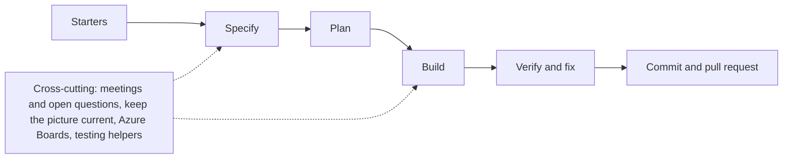

# CRAV1 Spec Kit (crav1)

**CRAV1 Spec Kit** (`crav1`) runs on **Cursor** and **Claude Code**. The slash commands are the same (`/crav1`, then `/crav1-…`). The install is not. Where the files go is [docs/install.md](docs/install.md).

It is a kit for spec-driven development: skills and agents that take a spark, a pile of ideas, intake files, a match of existing repos to a dump, a later dump onto specs that already exist, a code change that already landed onto those specs, or named repos into one architecture spec, through spec, plan, implement, verify, and a draft commit message. Specs, not chat history, are the source of truth. An always-on project instruction with the kit's standing rules ships with the install.

On Cursor, install plugin `crav1` from this GitHub repo (team marketplace import or a local plugin). There is no public Cursor Marketplace listing. On Claude Code, there is no plugin and no marketplace: copy `.claude/` into a repository you own, or into `~/.claude` for a client project. Cloning this kit does not install it into another product.

Repo: [crav1-spec-kit](https://github.com/Crav1on/crav1-spec-kit). After install on either host, type `/crav1`.

This is a process guide, not an application. Use it as a checklist when you start a repo, then install the kit into that project.

**Start here:** [First 15 minutes](docs/first-run.md). **Install:** [docs/install.md](docs/install.md). **Every command:** [skills reference](docs/reference/skills.md). **Every page:** [docs index](docs/README.md). License: [MIT](LICENSE).

## First 15 minutes

Pick an install path, open the product repo, then `/crav1` and one starter option. A spark continues tighten → plan → one task. The short path is [docs/first-run.md](docs/first-run.md). The method behind it is [docs/concepts/method.md](docs/concepts/method.md).

## The six starter options

When you ask for startup options, these six are the only ways in. That ask names the list. It does not run a skill. It does not move work into a lane. Each starter still follows the rules it already has. Every other skill is a later skill.

| Starter | When | Walkthrough |
| --- | --- | --- |
| [`/crav1-spark-to-spec`](docs/reference/skills/crav1-spark-to-spec.md) | One or two sentences | [From one sentence to a spec](docs/from-nothing.md) |
| [`/crav1-ideas-to-spec`](docs/reference/skills/crav1-ideas-to-spec.md) | A pile of ideas and technical hunches | [From a pile of ideas to a spec](docs/from-ideas.md) |
| [`/crav1-bundle-to-specs`](docs/reference/skills/crav1-bundle-to-specs.md) | Mixed files, or more than one v0 feature | [From intake files to specs](docs/from-intake.md) |
| [`/crav1-existing-to-specs`](docs/reference/skills/crav1-existing-to-specs.md) | Existing repos plus a dump to match | [From existing repos and a dump to specs](docs/from-match.md) |
| [`/crav1-existing-to-specs`](docs/reference/skills/crav1-existing-to-specs.md) | You name the repos. It runs only then | [From named repos to an architecture spec](docs/from-repos.md) |
| [`/crav1-read-environment`](docs/reference/skills/crav1-read-environment.md) | You name the host. It runs only then | [From a named host](docs/from-environment.md) |
| [`/crav1-fix-bug`](docs/reference/skills/crav1-fix-bug.md) | You name a real bug that already exists. It runs only then | [From a bug that already exists](docs/from-fix-bug.md) |

Starter options run only when named. Asking for startup options lists them and does not run one. All walkthroughs are listed in the [docs index](docs/README.md#how-to-walkthroughs).

## How the lanes fit

- Start with one starter option, then go Specify → Plan → Build → Verify → Commit and pull request.
- Every command says what it reads and what it writes. Anything not listed is left alone.
- Lanes per command: [guild routing](docs/guild-routing.md). Full rules per command: the [skills reference](docs/reference/skills.md), one page per skill.

| Lane | Groups | Reference |
| --- | --- | --- |
| Starters | The six ways in | [Starters](docs/reference/skills.md#starters) |
| Specify | Start, Specify | [Specify](docs/reference/skills.md#specify) |
| Plan | Plan | [Plan](docs/reference/skills.md#plan) |
| Build | Build, Verify and fix | [Build](docs/reference/skills.md#build) |
| Cross-cutting | Start, Meetings and open questions, Keep the picture current, Azure Boards, Testing helpers, Commit and pull request | [Cross-cutting](docs/reference/skills.md#cross-cutting) |

## Where next

The [docs index](docs/README.md) is the one map of every page, by type and by reader. From there: [walkthroughs](docs/README.md#how-to-walkthroughs) for one goal step by step, the [skills reference](docs/reference/skills.md) for one command in full, [install](docs/install.md) for Cursor or Claude Code, [the method](docs/concepts/method.md) for the working loop, setup, best practices, and templates, and the [data layout](docs/concepts/data-layout.md) and [glossary](docs/concepts/glossary.md).

Primary sources for the method: [GitHub Spec Kit](https://github.com/github/spec-kit/) and [OpenSpec](https://github.com/Fission-AI/OpenSpec). Host file locations and plan-UI notes are in [docs/install.md](docs/install.md).

## Support

Broken skill or install: open a [GitHub Issue](https://github.com/Crav1on/crav1-spec-kit/issues). Include the host and version, the install path, the command you ran, and what you expected versus what happened. Details: [SUPPORT.md](SUPPORT.md).

## Further reading

- [Kit repository](https://github.com/Crav1on/crav1-spec-kit) · [Docs index](docs/README.md) · [First 15 minutes](docs/first-run.md) · [Installing and using the kit](docs/install.md) · [Skills reference](docs/reference/skills.md) · [The method](docs/concepts/method.md) · [Guild routing](docs/guild-routing.md) · [Environment marks](docs/environments-marks.md) · [Cursor plugin quick start](plugins/crav1/README.md) · [Changelog](CHANGELOG.md) · [Contributing](CONTRIBUTING.md) · [Support](SUPPORT.md) · [MIT License](LICENSE)
- [GitHub Spec Kit](https://github.com/github/spec-kit/) · [GitHub Blog on spec-driven development (SDD)](https://github.blog/ai-and-ml/generative-ai/spec-driven-development-with-ai-get-started-with-a-new-open-source-toolkit/)
- [OpenSpec](https://github.com/Fission-AI/OpenSpec)
- [MADR (Markdown Architectural Decision Records)](https://adr.github.io/madr/)
- [EARS (Easy Approach to Requirements Syntax)](https://alistairmavin.com/ears/)
