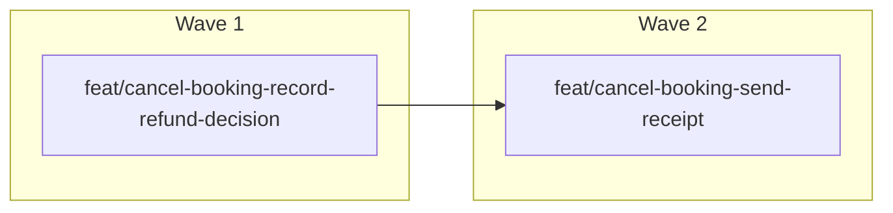

# Build map

One branch per plan step.

An arrow means the later branch waits for the earlier one.

## Wave 1: 1 branch, 1 can start now

### feat/cancel-booking-record-refund-decision

- Delivers: Record the refund decision.
- Tasks: T1 Persist the decision; T2 Reject an unknown booking
- Waits for: none
- Question: none
- Ready now: ready

## Wave 2: 1 branch, 1 can start now

### feat/cancel-booking-send-receipt

- Delivers: Send the receipt.
- Tasks: T3 Email the receipt
- Waits for: feat/cancel-booking-record-refund-decision
- Question: none
- Ready now: waits in order
