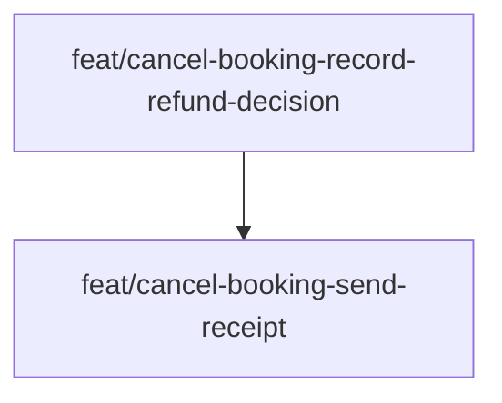

# Build map

One branch per plan step.

An arrow means the later branch waits for the earlier one.

## Wave 1

### feat/cancel-booking-record-refund-decision

- Delivers: Record the refund decision.
- Tasks: Persist the decision; Reject an unknown booking
- Waits for: none
- Question: none
- Ready now: ready

## Wave 2

### feat/cancel-booking-send-receipt

- Delivers: Send the receipt.
- Tasks: Email the receipt
- Waits for: feat/cancel-booking-record-refund-decision
- Question: none
- Ready now: waits in order
