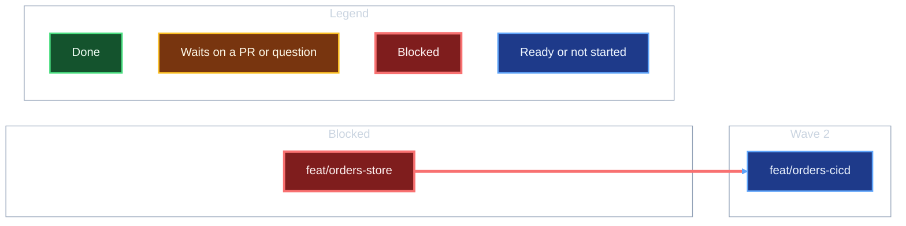

# Build map

To zoom the diagram, run `/crav1-tasks-ready-to-build orders-api-deadlock open-map`. To share the map as one file, run `/crav1-tasks-ready-to-build orders-api-deadlock export-map`.

The plan has no steps, so this map uses one branch per task.

An arrow means the later branch waits for the earlier one.

## Wave 2: 1 branch, 0 can start now

### feat/orders-cicd

- Delivers: Add the build pipeline
- Tasks: T3 Add the build pipeline
- Waits for: feat/orders-store
- Question: none
- Ready now: waits in order

## Blocked

### feat/orders-store

- Delivers: Store a retried order once; Take in develop, resolve conflicts and merge PR 11
- Tasks: T1 Store a retried order once; T2 Take in develop, resolve conflicts and merge PR 11
- Waits for: none
- Question: none
- Ready now: blocked, merge deadlock: T2 waits on T1, which ticks only when PR 11 merges
