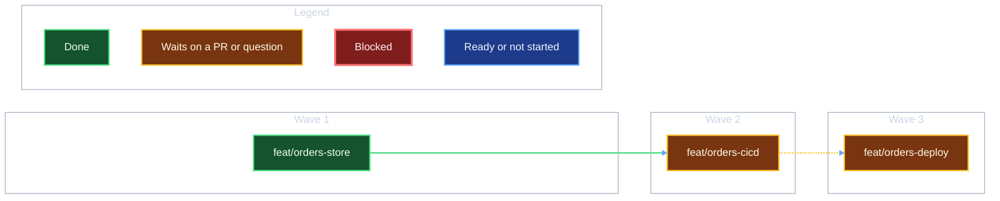

# Build map

The plan has no steps, so this map uses one branch per task.

An arrow means the later branch waits for the earlier one.

Wave 1 done (1 task)

## Wave 1: 1 branch, 0 can start now, 1 done

### feat/orders-store

- Delivers: ~~Store a retried order once~~ ✓ done (feat/orders-store)
- Tasks: ~~T1 Store a retried order once~~ ✓ done (feat/orders-store)
- Waited for: none
- Question: none
- Ready now: done

## Wave 2: 1 branch, 0 can start now

### feat/orders-cicd

- Delivers: Add the build pipeline
- Tasks: T2 Add the build pipeline
- Waits for: feat/orders-store
- Question: none
- Ready now: built, waits for PR 12 to merge

## Wave 3: 1 branch, 0 can start now

### feat/orders-deploy

- Delivers: Add the deploy stage
- Tasks: T3 Add the deploy stage
- Waits for: feat/orders-cicd
- Question: none
- Ready now: held, waits on feat/orders-cicd
