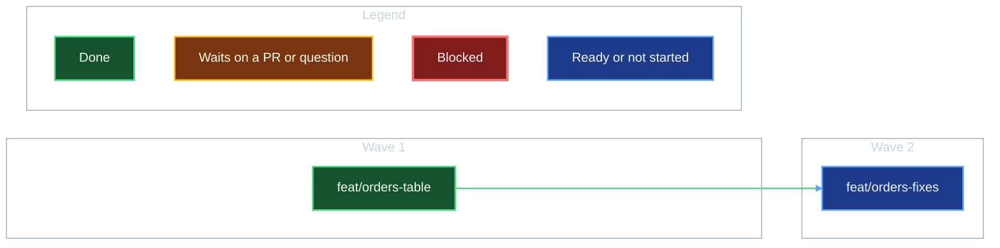

# Build map

The plan has no steps, so this map uses one branch per task.

An arrow means the later branch waits for the earlier one.

Wave 1 done (1 task)

## Wave 1: 1 branch, 0 can start now, 1 done

### feat/orders-table

- Tasks:
  - ~~Add the orders table (T1)~~ ✓ done (feat/orders-table)
- Waited for: none
- Question: none
- Ready now: done

## Wave 2: 1 branch, 0 can start now

### feat/orders-fixes

- Tasks:
  - A test of the 404 for an unknown order (T2)
  - A test of the order id guard (T3)
  - PR 7 takes in develop, conflicts resolved, whole suite green (T4)
- Waits for:
  - feat/orders-table
- Question: none
- Ready now: in progress
