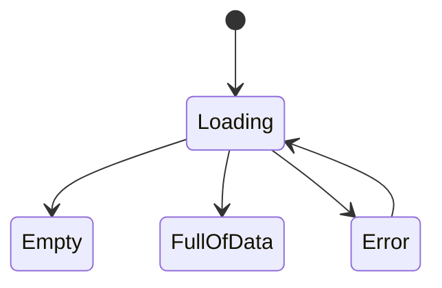

# UI experience: <slice name>

<!-- The behaviour file for this slice's user-facing UI (kit 1.211.0), written by $crav1-design-ui.
The written Markdown is the source of truth: a mock under ui/mock/ or a picture that disagrees with it loses.
One `### <name> (S<n>)` heading per screen or window. Each screen gets its own sign-off item in spec.md.
Screenshots are never stored in the repo: what a screenshot shows is written here as text. -->

## Screens

| Screen | Path or window | What it is for |
| --- | --- | --- |
| <Screen name> (S1) | <route, or the window name> | <one line> |

### <Screen name> (S1)

Path: <route, or the window name>

#### States

- Empty: <what shows when there is no data yet>
- Loading: <what shows while the data loads>
- Error: <what shows when loading or saving fails, and how to retry>
- Full of data: <what shows with the most rows, long names, and wide values>
- <Slice-specific state>: <when it happens and what shows>

#### Interactions

- Click: <what each control does when clicked>
- Keyboard: <tab order, shortcuts, Enter and Escape>
- Zoom and pan: <only when the screen zooms or pans; otherwise remove this line>
- Resize: <what changes at a narrow and a wide window>
- Dock: <only when windows dock or undock; otherwise remove this line>

#### Flow

#### Checks

<!-- UI acceptance checks: yes/no lines a stranger could mark. Plan traces each one into tasks.md as
(verify: ui — <named check>) (spec: ui/experience.md S1-C1). -->

- [ ] <With no data, the screen shows a short message and one way to add the first item.> (S1-C1)
- [ ] <While data loads, the screen shows a loading state and no stale rows.> (S1-C2)
- [ ] <When loading fails, the screen says what failed and offers a retry.> (S1-C3)
